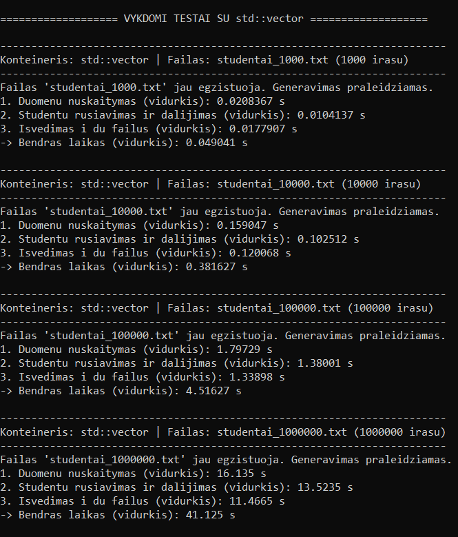
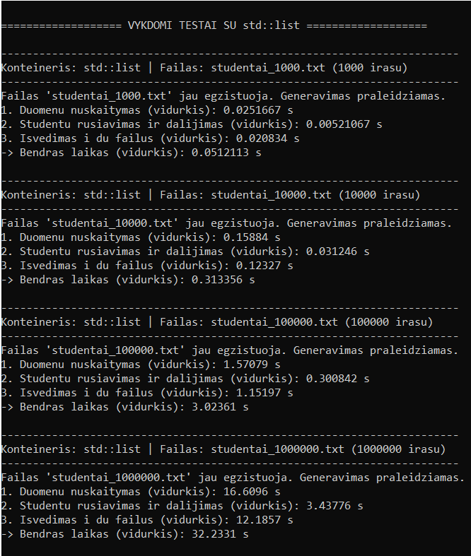

## V0.3 Versija - Konteinerių testavimas (std::vector ir std::list)

Šioje programos versijoje atliktas spartos tyrimas ir palyginimas, kaip keičiasi programos veikimo laikas naudojant skirtingus standartinės bibliotekos konteinerius: **std::vector** ir **std::list**.

## 1. Testavimo sistemos parametrai
* **Operacinė sistema (OS):** Windows 10 / 11
* **CPU (Procesorius):** Intel(R) Core(TM) i3-7020U CPU @ 2.30GHz
* **RAM (Atmintis):** 4 GB
* **Diskas:** SSD

---

## 2. Eksperimento rezultatai

Testavimas buvo atliktas su keturiais skirtingų dydžių failais (nuo 1 000 iki 1 000 000 įrašų). Kiekvienas testas paleistas po 3 kartus, o lentelėse pateikiami laiko **vidurkiai sekundėmis**.

### std::vector konteinerio rezultatai
| Įrašų kiekis | Nuskaitymas (vidurkis) | Rūšiavimas ir dalijimas (vidurkis) | Įrašymas į failus (vidurkis) | Bendras laikas |
| :--- | :--- | :--- | :--- | :--- |
| **1 000** | 0.0208 s | 0.0104 s | 0.0178 s | 0.0490 s |
| **10 000** | 0.1590 s | 0.1025 s | 0.1201 s | 0.3816 s |
| **100 000** | 1.7973 s | 1.3800 s | 1.3390 s | 4.5163 s |
| **1 000 000** | 16.1350 s | 13.5235 s | 11.4650 s | 41.1250 s |

### std::list konteinerio rezultatai
| Įrašų kiekis | Nuskaitymas (vidurkis) | Rūšiavimas ir dalijimas (vidurkis) | Įrašymas į failus (vidurkis) | Bendras laikas |
| :--- | :--- | :--- | :--- | :--- |
| **1 000** | 0.0252 s | 0.0052 s | 0.0208 s | 0.0512 s |
| **10 000** | 0.1588 s | 0.0312 s | 0.1233 s | 0.3134 s |
| **100 000** | 1.5708 s | 0.3008 s | 1.1520 s | 3.0236 s |
| **1 000 000** | 16.6096 s | 3.4378 s | 12.1857 s | 32.2331 s |

---

## 3. Rezultatų analizė ir išvados

* **Rūšiavimas ir dalijimas:** Žvelgiant į rezultatus pastebima, kad `std::list` konteineris rūšiavimo ir dalijimo etape su didesniais kiekiais (100k ir 1M įrašų) veikia ženkliai greičiau nei `std::vector` (pvz., prie 1 000 000 įrašų `std::list` užtruko ~3.44 s, o `std::vector` – ~13.52 s). Taip yra todėl, kad sąrašas naudoja savo vidinį `sort()` metodą, kuris keičia tik elementų rodykles (mazgus), o vektoriui tenka perstumti didelius atminties blokus.
* **Nuskaitymas ir įrašymas:** Duomenų nuskaitymo ir įrašymo į failus etapuose abiejų konteinerių laikai yra gana panašūs, nes pagrindinis laikas čia priklauso nuo disko (SSD) spartos ir srautų (`std::fstream`), o ne nuo pačio konteinerio vidinės struktūros.
