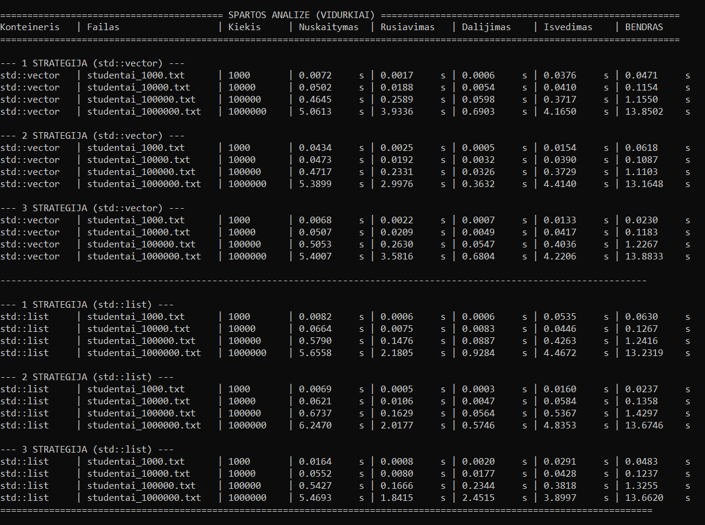

# Studentų rūšiavimo programa (V1.0)

## Versijų aprašymai

* **V0.1**
  Pradinė programos versija. Duomenys įvedami rankiniu būdu per konsolę, skaičiuojamas tik galutinis vidurkis ir namų darbų rezultatai. Rezultatai išvedami į ekraną.

* **v0.2**
  Pridėtas duomenų nuskaitymas iš failų ir atsitiktinių studentų bei jų pažymių failų generavimas (`std::vector` konteineryje). Įdiegtas galutinės medianos skaičiavimas, studentų rūšiavimas pagal pavardes bei surūšiuotų duomenų išvedimas į atskirus failus (`vargsiukai.txt` ir `kietiakiai.txt`).

* **V0.3**
  Projektas išskaidytas į atskirus modulių failus (`main.cpp`, `studentas.cpp`, `pagalbine.cpp` ir antraštinius failus). Realizuotas kelių konteinerių tipų (`std::vector` ir `std::list`) palaikymas bei trys skirtingos studentų dalijimo į dvi kategorijas strategijos. Taip pat pridėtas spartos matavimas laiko matavimo funkcijomis (`std::chrono`).

* **V1.0**
  Galutinė optimizuota programos versija. Atliktas spartos tyrimas su įvairaus dydžio failais (nuo 1 000 iki 1 000 000 įrašų), panaudoti efektyvūs STL algoritmai bei konteinerių manipuliavimo metodai. Projektas pilnai paruoštas naudojimui su įdiegimo instrukcijomis.

---
## Strategijų tyrimas ir spartos analizė

Strategijų tyrimo metu buvo ištirtos 3 skirtingos studentų skirstymo į dvi kategorijas (vargšiukai ir kietiakiai) strategijos naudojant `std::vector` ir `std::list` konteinerius.

### Dalijimo strategijų aprašymas:
* **1 strategija:** Bendro konteinerio (`studentai`) įrašai nuskaitomi ir pagal galutinį įvertinimą padalijami į du visiškai naujus konteinerius (`vargsiukai` ir `kietiakiai`). Originalus konteineris paliekamas nepakitęs, todėl reikalaujama dvigubai daugiau atminties.
* **2 strategija:** Naudojamas tik vienas naujas konteineris (`vargsiukai`). Studentai, kurių įvertinimas < 5.0, perkeliami/įrašomi į `vargsiukai` konteinerį ir ištrinami iš pagrindinio konteinerio (`studentai`), kuriame lieka tik `kietiakiai`.
* **3 strategija (optimizuota):** Panaudojami efektyvūs STL algoritmai (pvz., `std::stable_partition` arba `std::remove_copy_if`) ir efektyvus trynimas, minimizuojant elementų kopijavimą bei atminties perstumdymus.

---

### Spartos analizės rezultatai (Nuotrauka)



---

### Spartos analizės lentelės

#### 1. `std::vector` konteineris

| Strategija | Failas | Kiekis | Nuskaitymas (s) | Rūšiavimas (s) | Dalijimas (s) | Išvedimas (s) | BENDRAS (s) |
| :--- | :--- | :--- | :--- | :--- | :--- | :--- | :--- |
| **1 STRATEGIJA** | studentai_1000.txt | 1 000 | 0.0072 | 0.0017 | 0.0006 | 0.0376 | 0.0471 |
| | studentai_10000.txt | 10 000 | 0.0502 | 0.0188 | 0.0054 | 0.0410 | 0.1154 |
| | studentai_100000.txt | 100 000 | 0.4645 | 0.2589 | 0.0598 | 0.3717 | 1.1550 |
| | studentai_1000000.txt | 1 000 000 | 5.0613 | 3.9336 | 0.6903 | 4.1650 | 13.8502 |
| **2 STRATEGIJA** | studentai_1000.txt | 1 000 | 0.0434 | 0.0025 | 0.0005 | 0.0154 | 0.0618 |
| | studentai_10000.txt | 10 000 | 0.0473 | 0.0192 | 0.0032 | 0.0390 | 0.1087 |
| | studentai_100000.txt | 100 000 | 0.4717 | 0.2331 | 0.0326 | 0.3729 | 1.1103 |
| | studentai_1000000.txt | 1 000 000 | 5.3899 | 2.9976 | 0.3632 | 4.4140 | 13.1648 |
| **3 STRATEGIJA** | studentai_1000.txt | 1 000 | 0.0068 | 0.0022 | 0.0007 | 0.0133 | 0.0230 |
| | studentai_10000.txt | 10 000 | 0.0507 | 0.0209 | 0.0049 | 0.0417 | 0.1183 |
| | studentai_100000.txt | 100 000 | 0.5053 | 0.2630 | 0.0547 | 0.4036 | 1.2267 |
| | studentai_1000000.txt | 1 000 000 | 5.4007 | 3.5816 | 0.6804 | 4.2206 | 13.8833 |

---

#### 2. `std::list` konteineris

| Strategija | Failas | Kiekis | Nuskaitymas (s) | Rūšiavimas (s) | Dalijimas (s) | Išvedimas (s) | BENDRAS (s) |
| :--- | :--- | :--- | :--- | :--- | :--- | :--- | :--- |
| **1 STRATEGIJA** | studentai_1000.txt | 1 000 | 0.0082 | 0.0006 | 0.0006 | 0.0535 | 0.0630 |
| | studentai_10000.txt | 10 000 | 0.0664 | 0.0075 | 0.0083 | 0.0446 | 0.1267 |
| | studentai_100000.txt | 100 000 | 0.5790 | 0.1476 | 0.0887 | 0.4263 | 1.2416 |
| | studentai_1000000.txt | 1 000 000 | 5.6558 | 2.1805 | 0.9284 | 4.4672 | 13.2319 |
| **2 STRATEGIJA** | studentai_1000.txt | 1 000 | 0.0069 | 0.0005 | 0.0003 | 0.0160 | 0.0237 |
| | studentai_10000.txt | 10 000 | 0.0621 | 0.0106 | 0.0007 | 0.0584 | 0.1358 |
| | studentai_100000.txt | 100 000 | 0.6737 | 0.1629 | 0.0564 | 0.5367 | 1.4297 |
| | studentai_1000000.txt | 1 000 000 | 6.2470 | 2.0177 | 0.5746 | 4.8353 | 13.6746 |
| **3 STRATEGIJA** | studentai_1000.txt | 1 000 | 0.0164 | 0.0008 | 0.0020 | 0.0291 | 0.0483 |
| | studentai_10000.txt | 10 000 | 0.0552 | 0.0080 | 0.0177 | 0.0428 | 0.1237 |
| | studentai_100000.txt | 100 000 | 0.5427 | 0.1666 | 0.2344 | 0.3818 | 1.3255 |
| | studentai_1000000.txt | 1 000 000 | 5.4693 | 1.8415 | 2.4515 | 3.8997 | 13.6620 |

---

## Gautų rezultatų komentaras

Remiantis atliktais spartos analizės matavimais (testuojant su 1 000, 10 000, 100 000 ir 1 000 000 įrašų failais):

1. **Duomenų nuskaitymas ir išvedimas:** Nuskaitymas iš failo ir galutinis įrašymas į tekstinius failus užima didžiąją dalį bendro programos laiko (pavyzdžiui, 1 000 000 įrašų atveju nuskaitymas trunka apie 5 sekundes, o išvedimas – apie 4.1-4.4 sekundės). Tai rodo, kad operacijos su disku (I/O) yra pagrindinis spartos ribojantis veiksnis.
2. **Rūšiavimo trukmė (`std::vector` vs `std::list`):** Milijono elementų atveju `std::list` elementų rūšiavimas (`grupe.sort()`) užtrunka apie 1.8–2.1 sekundės, tuo tarpu `std::vector` rūšiavimas per `std::sort()` užtrunka ilgiau – apie 3.0–3.9 sekundės. Tai nutinka todėl, kad sąrašas keičia tik elementų rodykles (mazgus), o vektorius perkelia pačius objektus atmintyje.
3. **Strategijų įtaka dalijimui:** 1, 2 ir 3 strategijos parodo, kaip konteinerių pildymo ir trynimo metodika veikia veikimo spartą. Pavyzdžiui, antrojoje ir trečiojoje strategijoje vektoriui pritaikyti efektyvūs filtravimo metodai padeda sumažinti dalijimo trukmę išvengiant elementų perteklinio kopijavimo.

* **Rūšiavimas ir dalijimas:** Žvelgiant į rezultatus pastebima, kad `std::list` konteineris rūšiavimo ir dalijimo etape su didesniais kiekiais (100k ir 1M įrašų) veikia ženkliai greičiau nei `std::vector` (pvz., prie 1 000 000 įrašų `std::list` užtruko ~3.44 s, o `std::vector` – ~13.52 s). Taip yra todėl, kad sąrašas naudoja savo vidinį `sort()` metodą, kuris keičia tik elementų rodykles (mazgus), o vektoriui tenka perstumti didelius atminties blokus.
* **Nuskaitymas ir įrašymas:** Duomenų nuskaitymo ir įrašymo į failus etapuose abiejų konteinerių laikai yra gana panašūs, nes pagrindinis laikas čia priklauso nuo disko (SSD) spartos ir srautų (`std::fstream`), o ne nuo pačio konteinerio vidinės struktūros.

## Naudojimosi instrukcija

Paleidę programą, terminale galite pasirinkti vieną iš dviejų režimų:

1. **Automatinė spartos analizė** – atlieka spartos matavimus visiems testiniams failams, išbandydama abu konteinerių tipus (`std::vector` ir `std::list`) bei visas tris dalijimo strategijas.
2. **Įprastas programos režimas** – leidžia pasirinkti konkretų duomenų failą arba įvesti duomenis ranka, nurodyti rūšiavimo kriterijų ir įrašyti rezultatus.

Programos darbo metu sukurtstomi šie rezultatų failai:
* `vargsiukai.txt` – studentai, kurių galutinis vidurkis mažesnis nei 5.0.
* `kietiakiai.txt` – studentai, kurių galutinis vidurkis yra 5.0 arba didesnis.

## Įdiegimo ir paleidimo instrukcija

Projektą galima sukompiliuoti ir paleisti naudojant du paruoštus konfigūracijos failus:

1. Naudojant `CMakeLists.txt` (bet kokios OS atveju)
Jei sistemoje įdiegtas CMake ir C++ kompiliatorius, projekto šakniniame aplanke terminale įvykdykite šias komandas:

```bash
mkdir build
cd build
cmake ..
cmake --build .
```
Programos paleidimas:
Linux / macOS / Git Bash: ./programa
Windows: .\Debug\programa.exe

2. Naudojant Makefile (Unix / Linux / macOS aplinkai)
Jei naudojate Unix tipo aplinką ir turite make įrankį bei g++ kompiliatorių, projekto šakniniame aplanke įvykdykite:

```bash
make


